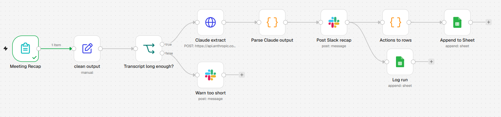

# Meeting-to-Action Assistant

An n8n + Claude workflow that turns a meeting transcript into a summary, decisions, assigned
actions and open questions, posts the recap to Slack, adds one row per action to a tracking Google Sheet and logs every run.

**The problem.** Nobody likes writing meeting notes, so actions get lost and owners are unclear.
This workflow produces the recap in about 15 seconds, without inventing owners or deadlines that
nobody stated. The transcript can be in any language; **the output is always in English**.
(The earlier French-output version is kept under the git tag `v1-french` and in [`legacy/fr/`](legacy/fr/).)



## Sample output

Slack recap for a fictional product sync dated 2026-11-02 (transcript: [`samples/01_product_sync.txt`](samples/01_product_sync.txt)):

```
📋 Weekly product sync (2026-11-02)

Decisions
• Pro plan stays at $49; the price cut to $39 is scrapped and will be revisited after the integrations ship.
• The webinar alongside the launch is dropped; the launch will be kept simple.

Actions
• Fix the login bug on the mobile app — Dev — 2026-11-03 (high)
• Compile the customer survey results and share them with everyone — Lena — 2026-11-06 (medium)
• Send the updated roadmap to the board — Tom — 2026-11-10 (medium)
• Write an email to beta users about the new features (sometime next week) — Lena — no due date (low)
• Book a venue for the December customer event — ⚠️ no owner — no due date (medium)
```

In the meeting the $39 price cut and the webinar were discussed and then cancelled, so only the final
decisions are recorded. "Sometime next week" stays `no due date` instead of becoming an invented date,
and the venue nobody volunteered for is flagged as having no owner.

## How it works

```
Form (title, date, participants, transcript)
        |
   Clean fields  --> word_count
        |
   Transcript long enough?  --no-->  Slack warning ("transcript too short")
        | yes
   Claude API (tool use -> structured JSON)
        |
   Parse + validate output (Code node)
        |
   Slack recap  ---->  one Google Sheet row per action (status: open)
        |
        +---------->  run log (date, title, word count, actions, minutes saved)

Any failure  --> Error workflow --> Slack alert with the failed step
```

- **Trigger:** n8n Form (title, date, participants, transcript).
- **Guard:** transcripts under 50 words are rejected with a clear Slack message.
- **Extraction:** HTTP Request to the Anthropic Messages API. Structured output comes from tool use
  (`save_meeting_summary`), so the result is typed JSON: `summary`, `decisions`, `actions`
  (`task`, `owner`, `due_date`, `priority`), `open_questions`.
- **Validation:** a Code node finds the `tool_use` block and merges title and date back in.
- **Outputs:** a formatted Slack recap (actions without owner or date are flagged) and one Sheet row per action with status `open`.
- **Usage log:** every run adds a row to the `Log` tab (date, title, word count, number of actions, 15 minutes saved, an
  assumption, not a measurement) and a counter shows hours saved.
- **Errors:** a separate error workflow posts a Slack alert with the failed step and a link to the execution.

## Run it yourself

1. In n8n, **Import from file** both `workflow/meeting-to-action.json` and `workflow/error-handler.json`.
2. Create your own credentials (Anthropic key as a Header Auth credential named `x-api-key`, Slack, Google Sheets)
   and select them on the nodes. No secrets are stored in the exports.
3. Point the two Google Sheets nodes at your own sheet and the Slack nodes at your channel. The sheet needs two tabs:
   `Sheet1` with the headers `date`, `meeting`, `task`, `owner`, `due_date`, `priority`, `status` (one row per action),
   and `Log` with `date`, `meeting_title`, `word_count`, `actions`, `minutes_saved` (one row per run).
4. In the main workflow's settings, set the error workflow to the imported handler, then publish both.

## Prompt versions

See [`prompts/v1.md`](prompts/v1.md).
- **v1** invented a precise date for a vague deadline ("next week").
- **v2** forces `null` for vague deadlines and keeps the wording in the task text (output in French).
- **v3 (current)** same rules, output always in English whatever the transcript language.

## Evaluation

`eval/run_eval.py` scores the extraction against hand-written ground truth for 3 English transcripts
(18 required actions), each with built-in traps: a reversed price decision, dropped items, a client
switching plans, vague deadlines, unowned tasks and a rambling stand-up.

| Run (prompt v3, English) | Action recall | Owner accuracy | Due-date accuracy | Hallucinated actions | Extra actions |
|---|---|---|---|---|---|
| Live run 1 | 18/18 (100%) | 18/18 (100%) | 18/18 (100%) | 0 | 0 |
| Live run 2 | 18/18 (100%) | 18/18 (100%) | 18/18 (100%) | 0 | 0 |

The earlier French version (prompt v2, 3 French transcripts, 15 required actions) scored 14/15 and then 15/15
on recall, with 100% owner and due-date accuracy and 0 hallucinations. Its first run flagged one missing action that
was actually present: the keyword matcher was too strict about wording. I fixed the matcher (any-of keyword
groups), not the model. Those results are kept in `eval/results/live_run_1.json` and `live_run_2.json`.

```bash
pip install -r requirements.txt
# PowerShell:  $env:ANTHROPIC_API_KEY = "your-key"
# macOS/Linux: export ANTHROPIC_API_KEY="your-key"
python eval/run_eval.py --out eval/results/live_run.json
# or score saved outputs without an API key:
python eval/run_eval.py --from-file eval/results/n8n_run_v1.json
```

The script exits with code 1 on any missing action, hallucinated action or failed decision check,
so it can run in CI.

**Caveat:** 3 transcripts is a small sample, and model output is not deterministic between runs. Two perfect runs
show the method works and catch regressions; they are not a statistical guarantee. I also wrote the transcripts
and the ground truth myself.

## Cost per meeting

Measured on one run of the rambling test transcript: **2,294 input tokens, 1,957 output tokens**. At Claude Sonnet 5.5
list price ($2 / M input, $10 / M output):

2,294 x $2/M + 1,957 x $10/M = $0.0046 + $0.0196 = **about $0.02 per meeting**.

For 20 meetings a month that is about **$0.40**. A real 45-minute meeting transcript is much longer (my estimate:
roughly 10-12k input tokens), which would give about $0.05 per meeting, around $1 a month.
Prices from the Anthropic pricing page at the time of writing.

## Privacy

The samples are fictional. Real client meetings contain personal data, so using this in production would need:
a data-processing agreement with the model provider, a decision on where transcripts and the Sheet are stored
and for how long, and a check on GDPR obligations before any real client information is sent.

## Known limits

- **Re-running a transcript appends duplicate rows** (no idempotency key yet).
- The eval uses keyword matching, which can reject a correct paraphrase.
- Minor model noise remains: some tasks keep a relative word such as "tomorrow" in the text, and a speculative open
  question sometimes appears.
- Forced tool choice (`tool_choice`) is rejected by this model, so the prompt instructs it to call the tool
  and the Code node handles the extra `thinking` block.
- Very long transcripts are not chunked yet.
- If a transcript contains a date that contradicts the meeting date, the model flags it as an open question
  rather than guessing.

## Next steps (adoption)

Where the tool meets the team, which is the hard part:
- Post in the Slack channel the team already reads (done) and add a trigger from a Slack message or a shared email address.
- A one-page guide (written, see [`docs/guide-en.md`](docs/guide-en.md), French version in [`docs/guide-fr.md`](docs/guide-fr.md)):
  what to paste, what comes out, what the tool does not do, who to ask.
- A feedback question under each recap ("Was this useful?"), logged in a second Sheet tab.
- Latency in the run log (the run log itself and the hours-saved counter are done; latency is not).
- Week one: send the recap to the meeting owner as a draft to approve before it reaches the channel.
- Find one enthusiastic colleague to try it first, run a 15-minute demo, collect 5 complaints and fix them the week after.

## Repo layout

```
workflow/   n8n exports (credentials removed)
prompts/    system prompt (v3), tool schema, version notes
samples/    3 fictional English transcripts
eval/       run_eval.py, ground truth, results
docs/       workflow screenshot, team guides (English and French)
legacy/fr/  the French-output version: prompt v2, samples, ground truth
```

## Stack

n8n Cloud, Anthropic Messages API (tool use), Slack, Google Sheets, Python 3.
