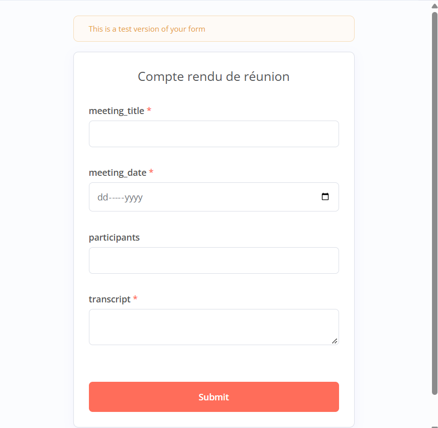
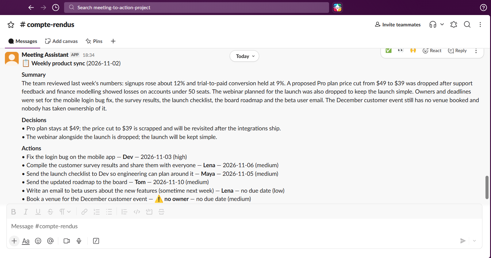
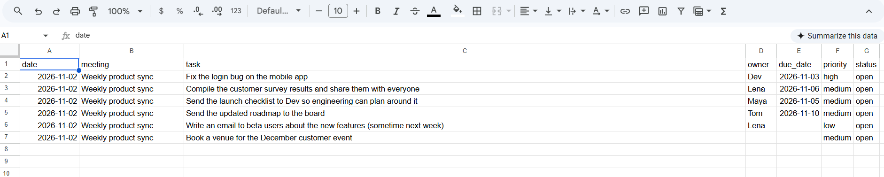

# Meeting Recap Assistant: one-page guide

> Version française : [guide-fr.md](guide-fr.md)

**What it is for.** You paste a meeting transcript, and about 15 seconds later the team gets a clear recap in Slack: summary, decisions, actions with an owner and a due date, and open questions. Every action is also added to the tracking sheet (Google Sheets). The transcript can be in any language; the recap is always written in English.

## How to use it (2 minutes)

1. Open the form (link pinned in the Slack channel).
2. Fill in: **title**, **meeting date** (use the right year), **participants**, then **paste the transcript**.

   

3. Click Submit. The recap shows up in the Slack channel a few seconds later.

   

4. Open the tracking sheet (link in the same channel): one row per run, with the title, word count and number of actions.

   

## What you get

- A **summary** of a few lines.
- The **final decisions**. If a price or a choice changed during the meeting, only the last version is kept.
- The **actions**: task, owner, due date, priority.
- The **open questions**: what was left undecided.

## What it does and does not do

- It is **designed not to invent anything**. If nobody took an action, it shows "⚠️ no owner". If nobody said a precise date ("next week", "as soon as possible"), it shows "no due date" and keeps your words in the task.
- It **does not replace proofreading**. Read the recap before acting on it, and correct mistakes directly in the sheet.
- It **does not summarise audio**. You need a text transcript. If it is too short (under 50 words), a warning appears in Slack.
- It **does not detect duplicates**. Submitting the same meeting twice creates two sets of rows.
- **Personal data:** do not send sensitive client information until production use has been validated (data-processing agreement, storage location).

## If something goes wrong

- A "Workflow failed" alert appears in Slack: the technical owner has been notified, and you can submit the form again a bit later.
- Questions, feedback, ideas: write in the Slack channel where the recaps are posted.

## Help us improve it

After each recap, tell us in the Slack thread whether it was **useful** or not, and why. We collect the first feedback for one week, then fix the most annoying issues.

*Time-saving assumption: 15 minutes saved per recap (an estimate, tracked in the "Log" tab of the sheet).*
